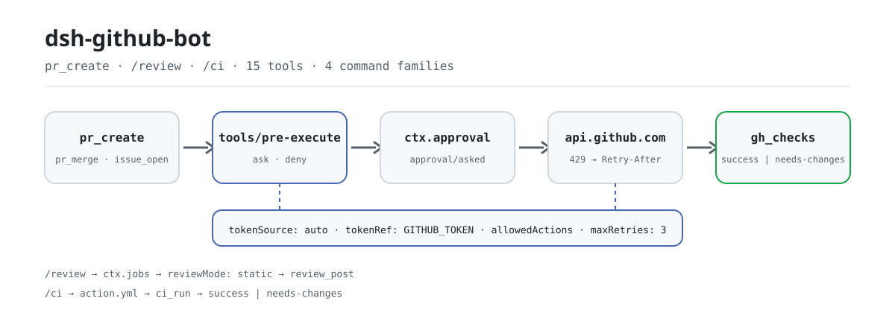

<div align="center">

<picture>
  <source media="(prefers-color-scheme: dark)" srcset="docs/assets/dsh-github-bot-flow-dark.svg">
  
</picture>

# dsh-github-bot

**एजेंट को GitHub के pull request, समीक्षा, issue और CI सीधे संभालने दें — हर write मानव-अनुमोदन से गुज़रता है और token कभी लॉग में नहीं जाता।**

DeepSeek Harness के लिए GitHub एकीकरण प्लगइन: pull request बनाएँ, समीक्षा करें, merge करें और खोजें; issue पढ़ें-लिखें; साथ में CI composite action, polling review bot और status-check gate।

[इंस्टॉल](#तीन-चरणों-में-शुरुआत) · [कॉन्फ़िगरेशन](#कॉन्फ़िगरेशन) · [FAQ](#faq) · [简体中文](README.md) · [English](README.en.md) · [Español](README.es.md) · [Português](README.pt.md) · [हिन्दी](README.hi.md)

[](LICENSE)
[](#संगतता)
[](https://www.npmjs.com/package/dsh-github-bot)
[](https://github.com/PerryLink/dsh-github-bot/actions/workflows/ci.yml)
[](#संगतता)

[](https://github.com/PerryLink/dsh-github-bot/stargazers)
[](https://www.npmjs.com/package/dsh-github-bot)
[](https://dshfind.com/plugins/PerryLink/dsh-github-bot?ref=badge)
[](https://securityscorecards.dev/viewer/?uri=github.com/PerryLink/dsh-github-bot)
[](https://dsh.market/)
[](https://gitee.com/perrylink/dsh-github-bot)

```sh
dsh plugin --profile <name> add dsh-github-bot
```

</div>

<sub>सामुदायिक प्लगइन, DeepSeek से असंबद्ध। कैनोनिकल रिपॉज़िटरी: <https://github.com/PerryLink/dsh-github-bot> (Gitee एक मिरर है)। पहले नाम `@perrylink/dsh-github` था; scoped पैकेज अब अप्रचलित है।</sub>

## यह क्या है

`dsh-github-bot` एजेंट के लिए GitHub का पूरा चक्र जोड़ता है: पढ़ने वाले काम (repository metadata, files, PR diffs, comments, CI checks, issue/PR खोज) सीधे चलते हैं; लिखने वाले काम (PR बनाना/अपडेट करना/merge करना, review प्रकाशित करना, issue खोलना/टिप्पणी करना/बंद करना, CI review चलाना) हमेशा `ctx.approval` से गुज़रते हैं — डिफ़ॉल्ट `ask`, और उत्तरदाता न हो तो अस्वीकार। GitHub token हर operation पर credentials seam से resolve होता है, केवल Authorization header में भेजा जाता है, और कभी logs, renders, events या errors में नहीं जाता। review engine डिफ़ॉल्ट रूप से deterministic static analyzer है — शून्य token, reproducible; model review के लिए `reviewMode: "model"` host के `subagents` seam से एक one-shot subagent भेजता है। रिपॉज़िटरी में CI composite action, polling review bot और status-check gate भी हैं, ताकि वही verdict CI में भी लागू हो।

<details>
<summary>विषय-सूची</summary>

- [यह क्या है](#यह-क्या-है)
- [तीन चरणों में शुरुआत](#तीन-चरणों-में-शुरुआत)
- [मुख्य क्षमताएँ](#मुख्य-क्षमताएँ)
- [कॉन्फ़िगरेशन](#कॉन्फ़िगरेशन)
- [FAQ](#faq)
- [सुरक्षा सीमाएँ](#सुरक्षा-सीमाएँ)
- [अनुमतियाँ और डेटा](#अनुमतियाँ-और-डेटा)
- [ज्ञात सीमाएँ](#ज्ञात-सीमाएँ)
- [अन्य DSH प्लगइनों के साथ इंटरऑपरेबिलिटी](#अन्य-dsh-प्लगइनों-के-साथ-इंटरऑपरेबिलिटी)
- [संगतता](#संगतता)
- [इकोसिस्टम और गुणवत्ता](#इकोसिस्टम-और-गुणवत्ता)
- [डेवलपमेंट](#डेवलपमेंट)
- [परिवार और आभार](#परिवार-और-आभार)
- [लाइसेंस](#लाइसेंस)

</details>

## तीन चरणों में शुरुआत

1. **इंस्टॉल करें** (एक चैनल चुनें):

   ```sh
   # git चैनल (नवीनतम main; git+https://github.com/PerryLink/dsh-github-bot.git के बराबर)
   dsh plugin --profile web add github:PerryLink/dsh-github-bot
   # npm चैनल (प्रकाशित रिलीज़)
   dsh plugin --profile web add dsh-github-bot
   # tarball चैनल: इस रेपो में pnpm pack करके
   dsh plugin --profile web add ./dsh-github-bot-<version>.tgz
   ```

   git चैनल का `prepare` स्क्रिप्ट केवल production dependencies से build करता है; इंस्टॉल के बाद मैन्युअल build की ज़रूरत नहीं।

   > npm पैकेज का नाम `dsh-github-bot` है; नंगा नाम `dsh-github` किसी अलग, असंबंधित प्रोजेक्ट का है — उसे इंस्टॉल करने से यह प्लगइन नहीं आता।

2. **token कॉन्फ़िगर करें** (एक तरीका चुनें; `tokenSource: auto` क्रम में credentials → env → gh resolve करता है):

   ```sh
   # अनुशंसित: dsh credentials फ़ाइल ($DSH_HOME/.credentials.yaml) में लिखें, key tokenRef के नाम से
   # या: उसी नाम का environment variable
   export GITHUB_TOKEN=ghp_…
   # या: gh CLI पहले से लॉगिन
   gh auth login
   ```

3. **माउंट सत्यापित करें**:

   ```sh
   dsh --profile web --dump-config | grep -A3 'id: dsh-github-bot'
   ```

**अनइंस्टॉल**: `dsh plugin --profile web remove dsh-github-bot` (या प्रोफ़ाइल पैच से वह पंक्ति हटाएँ)।

## मुख्य क्षमताएँ

`dsh-github-bot` `dsh` और Claude Code, Codex जैसे टूल के बीच का GitHub अंतर भरता है: एजेंट pull request पढ़, समीक्षा, खोल, अपडेट और merge कर सकता है, repository metadata और files पढ़ सकता है, issue पर टिप्पणी और बंद कर सकता है, और खोज सकता है — जबकि हर write को मानव स्वीकृति चाहिए और token गुप्त रहता है।

- **15 टूल** — `pr_create`, `pr_merge`, `pr_update`, `gh_review`, `review_post`, `gh_issue`, `issue_open`, `issue_comment`, `issue_close`, `gh_search`, `gh_repo`, `gh_file`, `gh_repo_search`, `gh_checks`, सभी `defineTool` से canonical JSON; `ci.enabled` चालू हो तो one-shot `ci_run` भी।
- **4 कमांड परिवार** — `/pr create`, `/review` (start/stop/post), `/issue open`, और `ci.enabled` के अंतर्गत पंजीकृत `/ci` (`scan`/`status`/`start`/`stop`/`run <pr>`)।
- **पूरा PR जीवनचक्र** — बनाना → समीक्षा → अपडेट (title/body/state/base) → merge (merge/squash/rebase, वैकल्पिक head-branch delete)।
- **लाइन-स्तरीय समीक्षा** — `review_post` एक summary comment या PR head commit पर line-anchored review comments प्रकाशित करता है।
- **अनुमोदन-नियंत्रित writes** — हर GitHub write `ctx.approval` से जाता है (डिफ़ॉल्ट `ask`, fail-closed); approval कारण title, body आकार और comment overrides का पूर्वावलोकन दिखाते हैं।
- **Token गोपनीयता** — credentials seam → environment → `gh` CLI, प्रति operation resolve, कभी logs, events, renders या errors में नहीं।
- **बैकग्राउंड review jobs** — `/review` host की अपनी `job_list` / `job_output` / `job_kill` सतह के साथ `ctx.jobs` पर चलता है।
- **लचीलापन** — `Retry-After`/`x-ratelimit-reset` backoff के साथ 429 retry; read tools concurrency-safe; सभी calls cancellation का सम्मान करते हैं।
- **CI सतह** — one-shot `ci_run` tool, polling review bot और status-check gate (composite action `action.yml`)।

### कमांड और टूल सतह

| सतह | प्रकार | नोट्स |
|---|---|---|
| `pr_create` | tool | pull request बनाता है (write; approval-नियंत्रित) |
| `pr_merge` | tool | PR merge करता है (merge/squash/rebase, वैकल्पिक head-branch delete) |
| `pr_update` | tool | PR update करता है (title/body/state/base) |
| `gh_review` | tool | PR पढ़ता है: metadata, capped diff, comments, CI, static findings |
| `review_post` | tool | review comment प्रकाशित करता है (summary या line-anchored inline) |
| `gh_issue` | tool | issues को list / get / comment करता है (PRs `kind: "pr"` marked) |
| `issue_open` | tool | issue बनाता है |
| `issue_comment` | tool | issue या PR पर comment करता है |
| `issue_close` | tool | issue बंद करता है (वैकल्पिक state reason) |
| `gh_search` | tool | issues और PRs खोजता है (अलग search quota) |
| `gh_repo` | tool | repository metadata पढ़ता है |
| `gh_file` | tool | किसी branch/tag/commit पर एक file पढ़ता है |
| `gh_repo_search` | tool | GraphQL repository खोज (अलग search quota) |
| `gh_checks` | tool | GraphQL PR status checks (check runs + commit statuses) |
| `/pr create` | command | git स्थिति पढ़ता है और `pr_create` instruction queue करता है |
| `/review` | command | background review job start / stop / post करता है |
| `/issue open` | command | `issue_open` instruction queue करता है |
| `ci_run` | tool | composite action / CI driver द्वारा चलाई गई one-shot CI review |
| review bot | surface | idempotent inline comments वाला polling review bot (`ci.*`) |
| status-check gate | surface | PR head commit के हिसाब से `success` / `needs-changes` verdict प्रकाशित करता है (`action.yml`) |

### उदाहरण

ये प्लगइन के वास्तविक प्रवेश बिंदु हैं; एक बार इंस्टॉल करके एक चलाएँ।

**विस्तृत उदाहरण** — टूल `pr_create`, इनपुट:

```json
{
  "title": "feat: shiny",
  "body": "desc"
}
```

आउटपुट:

```text
created pull request #7: https://github.com/o/r/pull/7 (main ← feat/shiny)
```

*Observed from `plugins/dsh-github-bot/test/tools.test.ts:69-74 (fixture + assertions); renderer at plugins/dsh-github-bot/src/tools.ts:189`*

**विफलता शाखा** — इनपुट:

```text
{"title":"x"} (credentials seam empty; GITHUB_TOKEN unset; gh not logged in)
```

आउटपुट:

```text
{
  "status": "error",
  "code": "no-token",
  "message": "no GitHub token found (source: credentials/env/gh)",
  "guidance": "Configure one of: 1) a dsh credential for this reference (recommended; $DSH_HOME/.credentials.yaml), 2) the same-named environment variable, or 3) `gh auth login` for the gh CLI. Set `tokenSource` in cordis.yml to pin one source."
}
```

*Observed from `plugins/dsh-github-bot/src/credential.ts:96-104; plugins/dsh-github-bot/test/tools.test.ts:88-93`*

**संक्षिप्त उदाहरण**: `pr_merge` · `gh_review`

### आर्किटेक्चर

- **Credential seam.** `tokenSource: auto` प्रति operation क्रम में resolve करता है: credentials seam (`GITHUB_TOKEN` reference) → environment variable → `gh` CLI token। मान REST client को दिया गया local variable है; वह कभी canonical values, renders, cards, command outputs, injected notices, job output, approval reasons या error messages में नहीं जाता।
- **Approval gate.** सभी writes model tools से होकर गुजरते हैं। `tools/pre-execute` waterfall listener write tools के लिए `ask` लौटाता है, इसलिए registry `ctx.approval` के ज़रिए मानव से पूछता है (host `approval/asked` + `approval/decided` audit pair लॉग करता है) और बिना answerer के fail closed हो जाता है। Commands कभी सीधे write नहीं करते: write command read-only context इकट्ठा करता है, फिर एजेंट को जगाता है ताकि model gated tool को एक turn के भीतर चलाए।
- **Background review job.** `/review <pr>` `ctx.jobs` पर `github-review` job शुरू करता है; job metadata (inline posting के लिए head-commit SHA), capped diff, CI checks और मौजूदा comments लाता है, फिर deterministic multi-file analyzer (`src/review.ts`) चलाता है। Job कॉल करने वाले agent के नंगे `SessionId` का है — `0.1.7-alpha.1` registry को `SessionId` पर fence करता है, `Agent` union के बिना — इसलिए `dsh-tool-jobs` composed होना चाहिए, वरना `start` मना कर देगा। `reviewMode: "model"` पर job capped diff host के `subagents` seam से one-shot subagent को सौंपता है। Completion host के `dsh-tool-jobs` consumer से session तक पहुँचती है; model उसे `job_output` से पढ़ता है और `review_post` से प्रकाशित करता है।
- **CI composite action / review bot / status-check gate.** Repo में composite action (`action.yml`) है जो PRs की समीक्षा करता है, CI ठीक करता है और report लिखता है; polling review bot idempotent inline comments प्रकाशित करता है; और status-check gate PR head commit के हिसाब से verdict प्रकाशित करता है। One-shot `ci_run` tool headless run चलाता है। हर write approval-gated रहता है।

## कॉन्फ़िगरेशन

सभी tunables Schemastery `Config` fields हैं (cordis.yml से बदले जा सकते हैं)। id-लक्षित override पूरी row बदल देता है — जो keys चाहिए उन्हें दोबारा लिखें। `cordis.patch.yml` हर key को inline दस्तावेज़ित करता है। GUI में **Plugins पेज settings card** (Official समूह) `tokenRef` उस entry के अपने configuration form से पढ़ता है — `0.1.7-alpha.1` host ने `ctx.settingsScope` binding और उसके पीछे का namespace-registration seam हटा दिया, इसलिए कार्ड अब कोई settings namespace नहीं रखता। GitHub token configuration field नहीं है: कार्ड बताता है कि referenced credential सेट है या नहीं, और उसे credentials फ़ाइल के ज़रिए लिखता है — host half वहीं से resolve करता है।

सबसे अधिक इस्तेमाल होने वाली keys:

| कुंजी | डिफ़ॉल्ट | अर्थ |
|---|---|---|
| `tokenSource` | `auto` | `auto` (credentials → env → gh) या `credentials` / `env` / `gh` में से कोई एक |
| `tokenRef` | `GITHUB_TOKEN` | Credential-seam reference / environment-variable नाम |
| `defaultOwnerRepo` | — | जब कोई call कोई नाम न दे और git के पास कोई origin न हो तो fallback `owner/repo` |
| `autoCommit` | `false` | क्या `/pr create` model को पहले commit+push करने का निर्देश दे सकता है |
| `maxDiffChars` | `8000` | reviews में पढ़े जाने वाले PR diffs की character सीमा |
| `reviewMode` | `static` | Review engine: `static` (deterministic analyzer) या `model` (host के `subagents` seam से one-shot subagent; seam अनुपस्थित होने पर fail loud) |
| `allowedActions` | `8 write actions` | Write-action whitelist; बाकी सब approval से पहले अस्वीकार |
| `ci` | `{ enabled: false, … }` | CI integration section: polling review bot, status-check gate और one-shot `ci_run` tool (सभी `ci.*` keys इसी में हैं) |

<details>
<summary>पूरी कॉन्फ़िगरेशन तालिका (22 keys)</summary>

| कुंजी | डिफ़ॉल्ट | अर्थ |
|---|---|---|
| `tokenSource` | `auto` | `auto` (credentials → env → gh) या `credentials` / `env` / `gh` में से कोई एक |
| `tokenRef` | `GITHUB_TOKEN` | Credential-seam reference / environment-variable नाम |
| `defaultOwnerRepo` | — | जब कोई call कोई नाम न दे और git के पास कोई origin न हो तो fallback `owner/repo` |
| `autoCommit` | `false` | क्या `/pr create` model को पहले commit+push करने का निर्देश दे सकता है |
| `maxDiffChars` | `8000` | reviews में पढ़े जाने वाले PR diffs की character सीमा |
| `renderExcerptChars` | `2000` | tool output में render किए जाने वाले diff excerpt की character सीमा |
| `maxComments` | `20` | `gh_review` द्वारा सूचीबद्ध PR comments की सीमा |
| `reviewJobTimeoutMs` | `600000` | एक background review job की समय-सीमा (`timeout` के साथ fail होता है) |
| `maxReviewRecords` | `50` | in-memory review-job records की सीमा; सबसे पुराने settled records पहले evict होते हैं |
| `maxFileChars` | `12000` | `gh_file` द्वारा पढ़े गए file contents की character सीमा |
| `maxFindings` | `50` | प्रति review analyzer findings की सीमा |
| `maxLineLength` | `300` | line length जिसके पार analyzer long-line finding flag करता है |
| `reviewMode` | `static` | Review engine: `static` (deterministic analyzer) या `model` (host के `subagents` seam से one-shot subagent; seam अनुपस्थित होने पर fail loud) |
| `modelReviewProvider` | — | `reviewMode: "model"` के लिए subagent provider नाम; डिफ़ॉल्ट रूप से पहले registered provider का उपयोग |
| `maxRetries` | `3` | प्रति request 429 retry प्रयास |
| `retryBaseMs` | `500` | Retry backoff आधार (प्रति प्रयास दोगुना) |
| `retryMaxWaitMs` | `60000` | Retry backoff की अधिकतम सीमा |
| `requestTimeoutMs` | `30000` | प्रति request hard timeout; exceed होने पर fetch abort |
| `apiBaseUrl` | `https://api.github.com` | GitHub REST base URL (GitHub Enterprise) |
| `allowedActions` | `8 write actions` | Write-action whitelist; बाकी सब approval से पहले अस्वीकार |
| `workspaceDir` | process cwd | read-only git inspection के लिए working directory |
| `ci` | `{ enabled: false, … }` | CI integration section: polling review bot, status-check gate और one-shot `ci_run` tool (सभी `ci.*` keys इसी में हैं) |

</details>

```text
allowedActions (default):
  pr.create, pr.merge, pr.update, review.post,
  issue.create, issue.comment, issue.close, ci.run
```

प्रोफ़ाइल पैच में override उदाहरण:

```yaml
- insert:
    - id: dsh-github-bot
      name: dsh-github-bot
      config:
        tokenSource: auto
        defaultOwnerRepo: PerryLink/dsh-github-bot
        autoCommit: false
```

## FAQ

<details>
<summary>Token वास्तव में कहाँ रहता है? क्या वह logs या errors में लीक हो सकता है?</summary>

Token configuration field नहीं है। `tokenSource: auto` प्रति operation इस क्रम में resolve करता है: credentials seam (`GITHUB_TOKEN` reference) → उसी नाम का environment variable → `gh` CLI; resolve हुआ मान REST client को दिया गया local variable है और केवल Authorization header में भेजा जाता है। वह कभी canonical values, renders, cards, command outputs, injected notices, job output, approval reasons या error messages में नहीं जाता। उसे `$DSH_HOME/.credentials.yaml` में `tokenRef` की key के साथ लिखना अनुशंसित तरीका है; host का settings card केवल बताता है कि referenced credential सेट है या नहीं और उसे credentials फ़ाइल से लिखता है।

</details>

<details>
<summary>होस्ट में approval answerer न हो तो क्या चुपचाप पास हो जाता है?</summary>

नहीं। Write tools `tools/pre-execute` पर `ask` माने जाते हैं, registry `ctx.approval` के ज़रिए मानव से पूछता है और host `approval/asked` + `approval/decided` audit pair लॉग करता है; answerer न होने पर निर्णय सबसे सख्त पर जाता है — कभी silent pass-through नहीं। Commands भी सीधे write नहीं करते: write command read-only context इकट्ठा करता है और एजेंट को जगाता है, जो gated tool को एक turn के भीतर चलाता है।

</details>

<details>
<summary>Background review job किस पर निर्भर है? रीस्टार्ट पर खो जाता है?</summary>

`/review <pr>` `ctx.jobs` पर `github-review` job शुरू करता है; job कॉल करने वाले agent के नंगे `SessionId` का है, इसलिए profile में `dsh-tool-jobs` composed होना चाहिए, वरना `start` मना कर देगा। Review report process memory में job id के आधार पर रहती है और disk पर कुछ durable नहीं लिखा जाता; record map `maxReviewRecords` से capped है (सबसे पुराने settled records पहले evict), इसलिए restart पर वह चली जाती है। Completion host के `dsh-tool-jobs` consumer से session तक पहुँचती है; model उसे `job_output` से पढ़ता है और `review_post` से प्रकाशित करता है।

</details>

<details>
<summary>क्या review tokens खर्च करता है या requests धीमी करता है?</summary>

डिफ़ॉल्ट `reviewMode: "static"` deterministic rule analyzer है — शून्य tokens, reproducible। केवल `reviewMode: "model"` host के `subagents` seam से model बुलाता है और tokens खर्च करता है। Reads `maxDiffChars`, `renderExcerptChars`, `maxComments` और `maxFileChars` से सीमित हैं; हर request का `requestTimeoutMs` है, और 429s `Retry-After`/`x-ratelimit-reset` backoff (`maxRetries`, `retryBaseMs`, `retryMaxWaitMs`) से retry होते हैं जबकि बची quota हर result पर दिखती है।

</details>

## सुरक्षा सीमाएँ

- **Approval, enforcement नहीं।** Writes official seam पर केवल `ask`/deny decisions उत्पन्न करते हैं; sandbox और approval systems ही enforcement authorities रहते हैं।
- **Fail closed।** Approval answerer अनुपस्थित होने पर सबसे सख्त decision पर degrade होता है — कभी silent pass-through नहीं।
- **Token कभी process से बाहर नहीं जाता।** यह प्रति operation पढ़ा जाता है और केवल Authorization header में भेजा जाता है; कभी logged, rendered, injected या errors में नहीं आता।
- **Approval से बाहर कोई write नहीं।** `/pr create` कभी खुद commit या push नहीं करता; `autoCommit: true` के साथ model वे writes bash tool के अपने approval gate से करता है। Review job कोई write नहीं करता; केवल `review_post` approval के बाद प्रकाशित करता है।
- **Untrusted content escaped और marked होता है।** `formatPostBody` diff से लिए गए file names को backtick- और HTML-escape करता है, और external GitHub content (files, bodies, comments, search results) renders में external के रूप में marked होता है।
- **Bounded work और rate limits।** 429s को backoff के साथ retry किया जाता है; शेष quota हर result पर (failures सहित) दिखाया जाता है।

## अनुमतियाँ और डेटा

- **अनुमतियाँ**: writes official approval seam पर चलते हैं; कुछ भी re-implement या bypass नहीं किया जाता। Plugin अपने workshop manifest में `network:outbound` और `filesystem:write` घोषित करता है।
- **डेटा**: review report process memory में job id के आधार पर रहती है; disk पर कुछ भी durable नहीं लिखा जाता।
- **Session log**: plugin कोई custom session event types नहीं जोड़ता; सारा model-visible content host-logged surfaces से होकर बहता है (`tool/result`, `user/message`, `command/run`, `approval/asked`…). Commands जो notices queue करते हैं वे plugin का अपना source kind ले जाते हैं, `{ kind: 'dsh-github-bot', form: 'notice', summary }` — host में कोई catch-all `plugin` kind नहीं है, और उसका session-format admission path उसे सीधे अस्वीकार करता है।

## ज्ञात सीमाएँ

- **कोई custom session events नहीं** — जानबूझकर (Architecture देखें); audit trails host के अपने event vocabulary पर निर्भर करते हैं।
- **Static analyzer by default** — deterministic rules (`src/review.ts`), शून्य tokens, reproducible। `reviewMode: "model"` tokens खर्च करता है और इसके लिए `subagents` seam व एक registered provider चाहिए।
- **Jobs और records process-local हैं** — review report plugin memory में job id के आधार पर रहती है; record map `maxReviewRecords` से capped है (सबसे पुराने settled records पहले evict होते हैं)।
- **npm `latest` dist-tags पुराने हैं** — `dsh-base` द्वारा दिए गए profile closure से install करें; कभी भी bare `npm i @deepseek-ai/dsh-tools` से न करें।

## अन्य DSH प्लगइनों के साथ इंटरऑपरेबिलिटी

**DSH `0.2.0-rc.2`** (वह रनटाइम जिसके लिए यह README प्रकाशित है) और 2026-10-05 को सर्वे किए गए उच्च-स्टार प्लगइन सेट के विरुद्ध सत्यापित।

यह प्लगइन अन्य प्लगइनों में **हस्तक्षेप नहीं करता**, उन उच्च-स्टार प्लगइनों सहित जो व्यापक रूप से इंस्टॉल हैं:

- **कोई टूल-नाम टकराव नहीं।** सभी टूल नेमस्पेस युक्त हैं; कोई भी ऐसा नंगा नाम नहीं लेता जो पहले से किसी अंतर्निहित टूल या अन्य प्लगइन का हो।
- **कोई सर्विस-की टकराव नहीं।** यह कोई सर्विस key प्रदान नहीं करता, इसलिए टकराव संभव नहीं।
- **कोई स्लॉट टकराव नहीं।** यह कोई क्लाइंट slot key पंजीकृत नहीं करता, इसलिए `shadows-shipped-ui` सीट के लिए प्रतिस्पर्धा नहीं करता।
- **कोई HTTP रूट टकराव नहीं।** यह कोई `webServer` प्रीफ़िक्स पंजीकृत नहीं करता।
- **कोई patch-लेयर टकराव नहीं।** बंडल patch केवल अपनी पंक्ति `insert` करता है; कभी किसी अंतर्निहित पंक्ति का `config` ओवरराइड नहीं करता।
- **कोई वैश्विक परिवर्तन नहीं।** यह प्रोटोटाइप नहीं बदलता, `process.env` नहीं लिखता, और वैश्विक fetch dispatcher प्रतिस्थापित नहीं करता।

**साझा ईवेंट लिसनर रचना से ही अहस्तक्षेपी हैं।** यह क्रम-संवेदनशील ईवेंट `tools/pre-execute` को `ctx.on()` से देखता है — Cordis का **ब्रॉडकास्ट** पंजीकरण, जहाँ हर लिसनर चलता है और कोई किसी दूसरे को वंचित नहीं कर सकता। **यहाँ प्रत्येक लिसनर `next()` से डेलिगेट करता है**, इसलिए श्रृंखला कभी शॉर्ट-सर्किट नहीं होती, और बदलाव `next()` के दिए मान पर लागू होता है, उसकी जगह लौटाया नहीं जाता:

- `tools/pre-execute` — also used by `cc-safety-net` (1576★).

स्थैतिक प्रमाण: इस रिपॉज़िटरी पर `dsh-plugin-doctor` के K10–K13 सभी `pass` हैं।

## संगतता

| सतह | स्थिति |
|---|---|
| Harness | DeepSeek Harness `dsh-v0.2.1-rc.2` (2026-10-18 को सत्यापित): `engines.dsh >=0.2.1-0 <0.3.0`; P0 compatibility पथों के regression tests हैं। |
| Node | `^22.19.0 \|\| >=24.0.0` |
| प्लेटफ़ॉर्म | सभी (host plugin; GitHub तक outbound network) |
| मॉडल | कोई भी (static review deterministic है; `reviewMode: "model"` वैकल्पिक) |

## इकोसिस्टम और गुणवत्ता

- [Gitee मिरर](https://gitee.com/perrylink/dsh-github-bot) (सिंक मिरर; GitHub ही canonical है)
- [dshfind प्लगइन पेज](https://dshfind.com/plugins/PerryLink/dsh-github-bot) (इंस्टॉल और रैंकिंग)
- [OpenSSF Scorecard रिपोर्ट](https://securityscorecards.dev/viewer/?uri=github.com/PerryLink/dsh-github-bot) ([.github/workflows/scorecard.yml](.github/workflows/scorecard.yml) से संचालित)
- [dsh-plugin-doctor सत्यापन रिपोर्ट](https://github.com/PerryLink/dsh-plugin-doctor#verified-徽章) (K10–K13 सभी `pass`)
- [DSH Market](https://dsh.market/) (सूचीबद्ध)
- **1024 स्टोर चैनल**: एक बार `npm i -g dsh1024`, फिर `dsh1024 plugin --profile web add dsh-github-bot` ([deepseek1024.com](https://deepseek1024.com) की इंस्टॉल रैंकिंग में गिना जाता है)
- [इकोसिस्टम ज्ञान-आधार](https://perrylink.github.io/dsh-plugin-guide/): मापे गए आँकड़े, मार्केटिंग नहीं — प्लगइन विकास गाइड · चयन डेटा · रखरखाव मानदंड

## डेवलपमेंट

```sh
pnpm install             # node ^22.19 || >=24
pnpm run build           # tsc --noEmitOnError → lib/ (fix-dts और client bundle सहित)
pnpm run prepare         # self-contained git-install build (scripts/prepare.mjs)
pnpm run prepublishOnly  # प्रकाशन से पहले build + test
pnpm test                # vitest run
pnpm run typecheck       # tsc --noEmit
pnpm run check:readmes   # README anchors, tools और config keys की जाँच करता है
```

अलग docs build नहीं है: README का hero [`scripts/gen-readme-assets.py`](scripts/gen-readme-assets.py) से बनता है (हाथ से लिखा SVG, दो skins) और दोबारा चलाया जा सकता है।

रिपॉज़िटरी संरचना:

```
src/index.ts          plugin entry (name/inject/apply, applyWithDeps for tests)
src/config.ts         Schemastery Config
src/types.ts          local structural views of host services + Context merging
src/credential.ts     token resolution (seam → env → gh), per operation
src/github.ts         REST client: 429 retry, rate limits, diff media type
src/git.ts            read-only git inspection + origin parsing for any API host
src/review.ts         deterministic diff analyzer + sanitized comment drafting
src/jobs.ts           github-review background job producer (metadata + diff + CI + comments)
src/approval-gate.ts  tools/pre-execute ask/deny gate with write previews
src/tools.ts          the fourteen model-facing tools
src/ci/               ci_run tool, polling review bot, status-check pipeline
src/commands.ts       /pr, /review, /issue
src/present.ts        pure UI-card presenters
test/                 vitest suite + mock host scaffolding + opt-in e2e smoke
cordis.patch.yml      bundle patch (one insert row)
scripts/prepare.mjs   self-contained git-install build
scripts/gen-readme-assets.py  README hero SVG generator
```

विषय: `dsh`, `dsh-plugin`, `deepseek-harness`, `github`, `pull-request`, `code-review`, `issue-tracker`

## परिवार और आभार

यह प्रोजेक्ट [PerryLink](https://github.com/PerryLink) के DeepSeek Harness प्लगइन परिवार का हिस्सा है (सभी Apache-2.0)। अगर यह उपयोगी लगे, **एक star अगले व्यक्ति को इसे खोजने में मदद करता है** — इससे कोई सुविधा अनलॉक नहीं होती।

- [@PerryLink](https://github.com/PerryLink) — निर्माता और maintainer: GitHub tool surface, approval gate, background review jobs, CI composite action, review bot, status-check gate और पाँच-भाषा docs।
- [@JosephTian876](https://github.com/JosephTian876) — unbundled `lib/client.js` रिपोर्ट (#11)।
- [@womeimingzi11](https://github.com/womeimingzi11) — browser-half module-loader registration रिपोर्ट (#14); factory-wrapped bundle बाद के रिलीज़ में आया।
- [@AraragiEro](https://github.com/AraragiEro) — Plugins settings पेज में GitHub token settings card (#6)।
- [@alexchenzl](https://github.com/alexchenzl) — DSH Directory पर plugin को सूचीबद्ध करने का निमंत्रण (#5)।

<details>
<summary>सभी प्लगइन खोलें</summary>

| **[dsh-aqua-input-check](https://github.com/PerryLink/dsh-aqua-input-check)** |  |
| **[dsh-archive-check](https://github.com/PerryLink/dsh-archive-check)** |  |
| **[dsh-auto-review](https://github.com/PerryLink/dsh-auto-review)** |  |
| **[dsh-autotier](https://github.com/PerryLink/dsh-autotier)** | 🧊 फ़्रोज़न — रेपो README देखें |
| **[dsh-bid-ca-precheck](https://github.com/PerryLink/dsh-bid-ca-precheck)** |  |
| **[dsh-bid-qual-check](https://github.com/PerryLink/dsh-bid-qual-check)** |  |
| **[dsh-cert-mcp](https://github.com/PerryLink/dsh-cert-mcp)** | 🧊 फ़्रोज़न — रेपो README देखें |
| **[dsh-checkpoint-rewind](https://github.com/PerryLink/dsh-checkpoint-rewind)** |  |
| **[dsh-click](https://github.com/PerryLink/dsh-click)** |  |
| **[dsh-composer-history](https://github.com/PerryLink/dsh-composer-history)** |  |
| **[dsh-contract-stance](https://github.com/PerryLink/dsh-contract-stance)** |  |
| **[dsh-customs-doc-check](https://github.com/PerryLink/dsh-customs-doc-check)** |  |
| **[dsh-data-quality](https://github.com/PerryLink/dsh-data-quality)** | 🧊 फ़्रोज़न — रेपो README देखें |
| **[dsh-demurrage-ledger](https://github.com/PerryLink/dsh-demurrage-ledger)** |  |
| **[dsh-doublecheck](https://github.com/PerryLink/dsh-doublecheck)** |  |
| **[dsh-drill-script-check](https://github.com/PerryLink/dsh-drill-script-check)** |  |
| **[dsh-eia-guide-check](https://github.com/PerryLink/dsh-eia-guide-check)** |  |
| **[dsh-emergency-plan](https://github.com/PerryLink/dsh-emergency-plan)** |  |
| **[dsh-essay-rubric-check](https://github.com/PerryLink/dsh-essay-rubric-check)** |  |
| **[dsh-evidence-check](https://github.com/PerryLink/dsh-evidence-check)** |  |
| **[dsh-export-ctl-check](https://github.com/PerryLink/dsh-export-ctl-check)** |  |
| **[dsh-fast](https://github.com/PerryLink/dsh-fast)** |  |
| **[dsh-fmea-table-check](https://github.com/PerryLink/dsh-fmea-table-check)** |  |
| **[dsh-forecast-penalty](https://github.com/PerryLink/dsh-forecast-penalty)** |  |
| **[dsh-fund-research](https://github.com/PerryLink/dsh-fund-research)** |  |
| **[dsh-github-bot](https://github.com/PerryLink/dsh-github-bot)** |  |
| **[dsh-gongwen-flow-check](https://github.com/PerryLink/dsh-gongwen-flow-check)** |  |
| **[dsh-gongwen-word-check](https://github.com/PerryLink/dsh-gongwen-word-check)** |  |
| **[dsh-guard-plan-qc](https://github.com/PerryLink/dsh-guard-plan-qc)** |  |
| **[dsh-hazchem-check](https://github.com/PerryLink/dsh-hazchem-check)** |  |
| **[dsh-hazplan-check](https://github.com/PerryLink/dsh-hazplan-check)** |  |
| **[dsh-hidden-risk-map](https://github.com/PerryLink/dsh-hidden-risk-map)** |  |
| **[dsh-hs-classify](https://github.com/PerryLink/dsh-hs-classify)** |  |
| **[dsh-icd-rule-check](https://github.com/PerryLink/dsh-icd-rule-check)** |  |
| **[dsh-industry-research](https://github.com/PerryLink/dsh-industry-research)** |  |
| **[dsh-lawcite-adapter](https://github.com/PerryLink/dsh-lawcite-adapter)** |  |
| **[dsh-laya](https://github.com/PerryLink/dsh-laya)** |  |
| **[dsh-lc-doc-check](https://github.com/PerryLink/dsh-lc-doc-check)** |  |
| **[dsh-learning-gap-check](https://github.com/PerryLink/dsh-learning-gap-check)** |  |
| **[dsh-library](https://github.com/PerryLink/dsh-library)** |  |
| **[dsh-local-ai](https://github.com/PerryLink/dsh-local-ai)** |  |
| **[dsh-lsp-actions](https://github.com/PerryLink/dsh-lsp-actions)** |  |
| **[dsh-mask](https://github.com/PerryLink/dsh-mask)** |  |
| **[dsh-mcp-panel](https://github.com/PerryLink/dsh-mcp-panel)** |  |
| **[dsh-medrec-qc](https://github.com/PerryLink/dsh-medrec-qc)** |  |
| **[dsh-memento](https://github.com/PerryLink/dsh-memento)** | 🧊 फ़्रोज़न — रेपो README देखें |
| **[dsh-nsfc-form-check](https://github.com/PerryLink/dsh-nsfc-form-check)** |  |
| **[dsh-nurse-record-check](https://github.com/PerryLink/dsh-nurse-record-check)** |  |
| **[dsh-observe](https://github.com/PerryLink/dsh-observe)** |  |
| **[dsh-origin-rvc-check](https://github.com/PerryLink/dsh-origin-rvc-check)** |  |
| **[dsh-ota-review-check](https://github.com/PerryLink/dsh-ota-review-check)** |  |
| **[dsh-output-styles](https://github.com/PerryLink/dsh-output-styles)** |  |
| **[dsh-paper-doc-adapter](https://github.com/PerryLink/dsh-paper-doc-adapter)** |  |
| **[dsh-permission-rules](https://github.com/PerryLink/dsh-permission-rules)** |  |
| **[dsh-permit-report-check](https://github.com/PerryLink/dsh-permit-report-check)** |  |
| **[dsh-pipeline-check](https://github.com/PerryLink/dsh-pipeline-check)** |  |
| **[dsh-pleading-draft](https://github.com/PerryLink/dsh-pleading-draft)** |  |
| **[dsh-plugin-doctor](https://github.com/PerryLink/dsh-plugin-doctor)** | 🚫 रिटायर्ड (रेपो संग्रहीत) |
| **[dsh-plugin-guide](https://github.com/PerryLink/dsh-plugin-guide)** |  |
| **[dsh-plugin-kit](https://github.com/PerryLink/dsh-plugin-kit)** | 🚫 रिटायर्ड (रेपो संग्रहीत) |
| **[dsh-plugin-upgrade](https://github.com/PerryLink/dsh-plugin-upgrade)** | 🚫 रिटायर्ड (रेपो संग्रहीत) |
| **[dsh-policy-brief-draft](https://github.com/PerryLink/dsh-policy-brief-draft)** |  |
| **[dsh-power-loss-split](https://github.com/PerryLink/dsh-power-loss-split)** |  |
| **[dsh-power-ticket-check](https://github.com/PerryLink/dsh-power-ticket-check)** |  |
| **[dsh-ppap-check](https://github.com/PerryLink/dsh-ppap-check)** |  |
| **[dsh-protest-deadline](https://github.com/PerryLink/dsh-protest-deadline)** |  |
| **[dsh-railway-window](https://github.com/PerryLink/dsh-railway-window)** |  |
| **[dsh-repair-order-qc](https://github.com/PerryLink/dsh-repair-order-qc)** |  |
| **[dsh-research-report](https://github.com/PerryLink/dsh-research-report)** |  |
| **[dsh-review-reply-check](https://github.com/PerryLink/dsh-review-reply-check)** |  |
| **[dsh-rulefile-check](https://github.com/PerryLink/dsh-rulefile-check)** |  |
| **[dsh-safety-brief-check](https://github.com/PerryLink/dsh-safety-brief-check)** |  |
| **[dsh-score](https://github.com/PerryLink/dsh-score)** | 🧊 फ़्रोज़न — रेपो README देखें |
| **[dsh-session-sync](https://github.com/PerryLink/dsh-session-sync)** |  |
| **[dsh-site-log-check](https://github.com/PerryLink/dsh-site-log-check)** |  |
| **[dsh-skill-pack-security](https://github.com/PerryLink/dsh-skill-pack-security)** |  |
| **[dsh-soe-decision-check](https://github.com/PerryLink/dsh-soe-decision-check)** |  |
| **[dsh-soilwater-check](https://github.com/PerryLink/dsh-soilwater-check)** |  |
| **[dsh-sop-sync-check](https://github.com/PerryLink/dsh-sop-sync-check)** |  |
| **[dsh-spc-gbt-adapter](https://github.com/PerryLink/dsh-spc-gbt-adapter)** |  |
| **[dsh-talk](https://github.com/PerryLink/dsh-talk)** |  |
| **[dsh-tender-extract](https://github.com/PerryLink/dsh-tender-extract)** |  |
| **[dsh-tender-matrix](https://github.com/PerryLink/dsh-tender-matrix)** |  |
| **[dsh-test-drive](https://github.com/PerryLink/dsh-test-drive)** |  |
| **[dsh-ticktick](https://github.com/PerryLink/dsh-ticktick)** | 🚫 रिटायर्ड (रेपो संग्रहीत) |
| **[dsh-translate](https://github.com/PerryLink/dsh-translate)** |  |
| **[dsh-warranty-calc](https://github.com/PerryLink/dsh-warranty-calc)** |  |
| **[dsh-budget](https://github.com/PerryLink/dsh-budget)** |  |
| **[dsh-claude-move](https://github.com/PerryLink/dsh-claude-move)** |  |
| **[dsh-defend](https://github.com/PerryLink/dsh-defend)** |  |
| **[dsh-draw](https://github.com/PerryLink/dsh-draw)** | 🧊 फ़्रोज़न — रेपो README देखें |
| **[dsh-reach](https://github.com/PerryLink/dsh-reach)** |  |
| **[dsh-background-agents](https://github.com/PerryLink/dsh-background-agents)** | 🚫 रिटायर्ड (रेपो संग्रहीत) |
| **[dsh-session-pin](https://github.com/PerryLink/dsh-session-pin)** | 🚫 रिटायर्ड (रेपो संग्रहीत) |
| **[dsh-team-rooms](https://github.com/PerryLink/dsh-team-rooms)** | 🚫 रिटायर्ड (रेपो संग्रहीत) |

</details>

## लाइसेंस

[LICENSE](LICENSE) (Apache License 2.0) © 2026 dsh-github-bot contributors

<p align="center"><sub>Apache-2.0 · सामुदायिक प्लगइन, DeepSeek से असंबद्ध।</sub></p>
